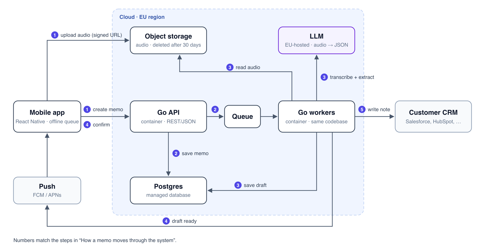

# Part 1: How I would build VoiceLine

My assumptions: reps record on the go, often with bad signal. Memos are short
(under 10 minutes), in German or English. The customer's CRM stays the source
of truth. Customers are B2B companies in the EU, so GDPR and EU hosting matter
from the start.

## Overview

## Tech

- **App:** React Native, so one codebase for iOS and Android. A recording is
  saved on the phone first and uploaded in the background, so a bad connection
  never loses a memo.
- **Backend:** Go. One codebase, deployed twice: as the API and as workers. I
  wouldn't start with microservices.
- **Data:** a managed Postgres for users, memos and CRM sync state. Object
  storage (e.g. S3 or Google Cloud Storage) for the audio, deleted
  automatically after 30 days.
- **Queue:** a managed queue (e.g. SQS or Pub/Sub) between the steps, so each
  step can retry on its own.
- **AI:** an LLM that takes audio directly and is hosted in the EU, e.g. Gemini
  on Vertex AI or Azure OpenAI. Audio in, JSON out (with a schema), like in
  part 2. The model sits behind a small interface, so it can be swapped.
- **CRM:** one connector per CRM, with OAuth per customer.
- **Login:** a managed identity provider with SSO (e.g. Microsoft Entra ID),
  because B2B customers want to manage their users centrally. Every record in
  the database belongs to one customer account.
- **Infra:** one cloud in an EU region (AWS, GCP or Azure; whichever the team
  knows best), containers on a managed runtime, Terraform, CI/CD and a secrets
  manager. I deployed part 2 on Google Cloud Run.

## How a memo moves through the system

1. The app uploads the audio straight to object storage, then calls
   `POST /memos` on the API. The request has an idempotency key, so a retry
   doesn't create the memo twice.
2. The API saves the memo and publishes an event.
3. A worker reads the audio from storage, sends it to the LLM and gets
   the transcript and the structured note back. It validates the result and
   saves it as a draft in Postgres.
4. The worker sends a push notification. The rep checks the draft in the app
   and confirms, which is another call to the API. I'd keep this review step,
   because a CRM update is visible to the whole team.
5. The API publishes another event, and a worker writes the note to the CRM.
   If the CRM is down, the message stays in the queue and is retried later.

The app talks to the API over plain REST/JSON. Inside the backend, steps only
talk through the queue. Updates go back to the app as push notifications.

## What I'd care about early

- **Prompt quality:** a small set of real (anonymised) memos in German and
  English that runs whenever the prompt or model changes. The output changes
  between runs, so testing by hand isn't enough.
- **Privacy:** EU hosting, no transcripts in logs, short audio retention.
- **Cost:** limits per user and a budget alert for AI spend.

## How part 2 fits in

Part 2 does steps 3 and 5 in one request: upload, Gemini, then Notion and
Google Sheets. To grow it into this design, I'd move the upload to object
storage, put a queue between the steps and add the review step. The LLM code
and the connectors would stay the same.
